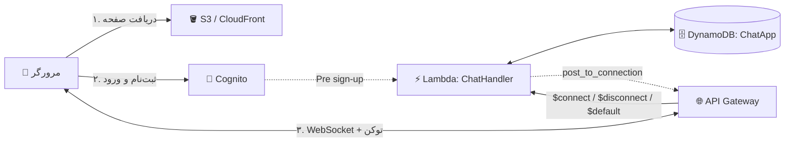

# 💬 چت‌روم بلادرنگ کلاسی (ClassChatApp) — نسخه ۲

یک چت‌روم **سرورلس** روی `AWS` با گفتگوی عمومی، پیام خصوصی، گروه و کانال (با مدیریت و لینک دعوت)، جستجوی کاربران و تاریخچه پیام‌ها. ثبت‌نام و ورود بدون نیاز به تأیید ایمیل یا تأیید دستی است.

---

## 📑 فهرست

1. [نمای کلی و قابلیت‌ها](#-نمای-کلی-و-قابلیتها)
2. [معماری](#-معماری)
3. [مدل داده (یک جدول)](#-مدل-داده-یک-جدول)
4. [مرحله ۱: DynamoDB](#-مرحله-۱-dynamodb)
5. [مرحله ۲: Cognito](#-مرحله-۲-cognito)
6. [مرحله ۳: IAM](#-مرحله-۳-iam)
7. [مرحله ۴: Lambda](#-مرحله-۴-lambda)
8. [مرحله ۵: اتصال Trigger به Cognito](#-مرحله-۵-اتصال-trigger-به-cognito)
9. [مرحله ۶: API Gateway](#-مرحله-۶-api-gateway)
10. [مرحله ۷: index.html و S3](#-مرحله-۷-indexhtml-و-s3)
11. [تست نهایی](#-تست-نهایی)
12. [پروتکل پیام‌ها](#-پروتکل-پیامها)
13. [نکات Free Tier](#-نکات-free-tier)
14. [عیب‌یابی](#-عیبیابی)
15. [تغییرات نسبت به نسخه قبل](#-تغییرات-نسبت-به-نسخه-قبل)

---

## 🧭 نمای کلی و قابلیت‌ها

| سرویس | نقش در پروژه |
| ----- | ------------ |
| `S3` (و در صورت نیاز `CloudFront`) | میزبانی فایل `index.html` |
| `Cognito` | ثبت‌نام و ورود کاربران |
| `API Gateway` (از نوع `WebSocket`) | اتصال زنده و مسیریابی پیام‌ها |
| `Lambda` | **یک تابع** برای همه کارها: اتصال، قطع اتصال، پیام‌ها و `Trigger` ثبت‌نام |
| `DynamoDB` | **یک جدول** برای کاربران، اتصال‌ها، گروه‌ها و پیام‌ها |
| `IAM` | دسترسی حداقلی برای `Lambda` |

**قابلیت‌ها**

- گفتگوی عمومی برای همه
- پیام خصوصی با جستجوی کاربر بر اساس شناسه، یا کلیک روی نام فرستنده
- فهرست کاربران آنلاین
- گروه (همه می‌نویسند) و کانال (فقط مدیران می‌نویسند)
- نقش‌ها: مالک، مدیر، عضو؛ حذف عضو، ارتقا و عزل مدیر، خروج و حذف گروه
- لینک دعوت (به شکل `#join=کد`) با امکان ساخت لینک جدید
- تاریخچه ۳۰ پیام آخر و دکمه «پیام‌های قبلی»
- شمارنده پیام‌های خوانده‌نشده و اتصال مجدد خودکار

---

## 🏗 معماری



توکن `Cognito` هنگام اتصال به‌صورت پارامتر `?token=` فرستاده می‌شود و `Lambda` امضای آن را بررسی می‌کند. نام کاربری هیچ‌وقت از سمت کلاینت پذیرفته نمی‌شود.

---

## 🗄 مدل داده (یک جدول)

جدول `ChatApp` کلیدهای `PK` و `SK` دارد و یک ایندکس به نام `GSI1` (با کلیدهای `GSI1PK` و `GSI1SK`) هم دارد:

| داده | `PK` | `SK` | `GSI1PK` / `GSI1SK` |
| ---- | ---- | ---- | ------------------- |
| پروفایل کاربر | `USER#نام` | `PROFILE` | `USERS` / نام (برای جستجو) |
| فهرست پیام‌های خصوصی | `USER#نام` | `DM#طرف‌مقابل` | ندارد |
| اتصال فعال | `CONN#id` | `META` | `ONLINE` / `id` (برای آنلاین‌ها) |
| اطلاعات گروه | `ROOM#id` | `META` | ندارد |
| عضو گروه | `ROOM#id` | `MEMBER#نام` | `UROOM#نام` / شناسه گروه |
| لینک دعوت | `INVITE#کد` | `META` | ندارد |
| پیام | `CHAT#شناسه‌گفتگو` | `MSG#زمان#تصادفی` | ندارد |

شناسه گفتگو سه شکل دارد:

- گفتگوی عمومی: `public`
- گروه و کانال: `room:<id>`
- پیام خصوصی: `dm:<نامA>:<نامB>` (نام‌ها به ترتیب الفبا)

---

## 🗄 مرحله ۱: DynamoDB

1. در کنسول وارد بخش `DynamoDB` شوید، سپس `Tables` و بعد `Create table` را بزنید.
2. نام جدول را `ChatApp` بگذارید.
3. کلیدها را به این شکل تنظیم کنید:
   - کلید پارتیشن (`Partition key`): نام `PK` و نوع `String`
   - کلید مرتب‌سازی (`Sort key`): نام `SK` و نوع `String`
4. در بخش `Table settings` گزینه `Customize settings` را بزنید.
5. در بخش `Read/write capacity settings` حالت `Provisioned` را انتخاب کنید و `Auto scaling` را برای هر دو (خواندن و نوشتن) خاموش کنید. مقدار `10` برای `Read` و `10` برای `Write` بگذارید. (حالت `On-demand` جزو سهمیه همیشه‌رایگان نیست.)
6. جدول را بسازید.
7. وارد جدول شوید، به بخش `Indexes` بروید و `Create index` را بزنید:
   - کلید پارتیشن: نام `GSI1PK` و نوع `String`
   - کلید مرتب‌سازی: نام `GSI1SK` و نوع `String`
   - نام ایندکس: `GSI1`
   - بخش `Projection` را روی `All` بگذارید.
   - ظرفیت `Provisioned` را برای خواندن `5` و برای نوشتن `5` بگذارید.
8. به بخش `Additional settings` بروید، گزینه `Time to Live (TTL)` را روشن کنید (`Turn on`) و نام صفت را `expiresAt` بگذارید. با این کار اتصال‌های مرده و پیام‌های قدیمی (بعد از ۳۰ روز) خودکار پاک می‌شوند.

---

## 🔐 مرحله ۲: Cognito

1. در کنسول وارد `Cognito` شوید و `Create user pool` را بزنید.
2. نوع برنامه را `Single-page application (SPA)` انتخاب کنید و نام آن را `ClassChatApp` بگذارید.
3. در بخش `Sign-in identifiers` فقط گزینه `User name` را انتخاب کنید.
4. در بخش `Required attributes` همان `email` پیش‌فرض بماند. (صفحه به‌صورت خودکار یک ایمیل ساختگی می‌فرستد.)
5. مقدار `Return URL` را `http://localhost` بگذارید. (فقط برای ساخت لازم است.)
6. پس از ساخت، رمز عبور را ساده‌تر کنید:
   - به بخش `Authentication` و سپس `Authentication methods` بروید.
   - روی `Password policy` و بعد `Edit` بزنید.
   - حالت `Custom` را انتخاب کنید.
   - حداقل طول را `6` بگذارید.
   - همه تیک‌های الزامی (عدد، حروف بزرگ و ...) را خاموش کنید.
7. گزینه `MFA` را روی `No MFA` بگذارید.
8. در بخش `Sign-up`، گزینه ارسال پیام برای تأیید (`Attribute verification`) را غیرفعال کنید (`Disable`).
9. این دو مقدار را یادداشت کنید:
   - شناسه `User pool ID` را از صفحه `Overview` بردارید.
   - شناسه `Client ID` را از بخش `App clients` بردارید.

> نام منوها در کنسول `AWS` گاهی تغییر می‌کند. اگر دقیقاً مطابق متن نبود، همین گزینه‌ها را در همان بخش‌ها جستجو کنید.

---

## 🛡 مرحله ۳: IAM

1. در کنسول وارد `IAM` شوید، به بخش `Policies` بروید، `Create policy` را بزنید و تب `JSON` را انتخاب کنید. متن زیر را بگذارید و به‌جای `REGION` و `ACCOUNT_ID` مقدار واقعی خودتان را بنویسید (مثلاً ریجن `eu-north-1`):

```json
{
  "Version": "2012-10-17",
  "Statement": [
    {
      "Effect": "Allow",
      "Action": [
        "dynamodb:GetItem",
        "dynamodb:PutItem",
        "dynamodb:UpdateItem",
        "dynamodb:DeleteItem",
        "dynamodb:Query",
        "dynamodb:BatchWriteItem"
      ],
      "Resource": [
        "arn:aws:dynamodb:REGION:ACCOUNT_ID:table/ChatApp",
        "arn:aws:dynamodb:REGION:ACCOUNT_ID:table/ChatApp/index/GSI1"
      ]
    },
    {
      "Effect": "Allow",
      "Action": "execute-api:ManageConnections",
      "Resource": "arn:aws:execute-api:REGION:ACCOUNT_ID:*/*"
    }
  ]
}
```

2. نام این `Policy` را `ChatAppAccess` بگذارید.
3. به بخش `Roles` بروید، `Create role` را بزنید، گزینه `AWS service` و سپس `Lambda` را انتخاب کنید و این دو `Policy` را اضافه کنید:
   - `ChatAppAccess`
   - `AWSLambdaBasicExecutionRole` (برای نوشتن لاگ در `CloudWatch`؛ بدون آن عیب‌یابی تقریباً ممکن نیست)
4. نام نقش را `ChatLambdaRole` بگذارید.

---

## ⚡ مرحله ۴: Lambda

1. در کنسول وارد `Lambda` شوید و `Create function` را بزنید، سپس گزینه `Author from scratch` را انتخاب کنید.
2. نام تابع را `ChatHandler` و `Runtime` را `Python 3.12` بگذارید.
3. در بخش `Change default execution role` گزینه `Use an existing role` را بزنید و نقش `ChatLambdaRole` را انتخاب کنید.
4. محتوای فایل `lambda_function.py` را در ویرایشگر کد جایگزین کنید و `Deploy` بزنید. (مقدار پیش‌فرض `Handler` یعنی `lambda_function.lambda_handler` درست است و به `Layer` یا بسته اضافه نیاز نیست.)
5. به بخش `Configuration` و سپس `General configuration` بروید، `Edit` را بزنید و این مقادیر را بگذارید:
   - حافظه (`Memory`): `256 MB`
   - زمان مجاز (`Timeout`): `15 sec`
6. در بخش `Configuration` و سپس `Environment variables`، این متغیرها را اضافه کنید:

| نام متغیر | مقدار |
| --------- | ----- |
| `TABLE_NAME` | `ChatApp` |
| `USER_POOL_ID` | شناسه `User pool` از مرحله ۲ |
| `CLIENT_ID` | شناسه `App client` از مرحله ۲ |
| `COGNITO_REGION` | ریجن `Cognito` (مثلاً `eu-north-1`) |

---

## 🔗 مرحله ۵: اتصال Trigger به Cognito

این مرحله باعث می‌شود ثبت‌نام بدون تأیید ایمیل و بدون تأیید دستی انجام شود. همان `Lambda` قبلی این کار را هم انجام می‌دهد، پس تابع جدیدی لازم نیست.

1. در `Cognito` وارد `User pool` خودتان شوید، به بخش `Extensions` بروید و `Add Lambda trigger` را بزنید.
2. در `Trigger type` گزینه `Sign-up` را انتخاب کنید و نوع آن را `Pre sign-up trigger` بگذارید.
3. تابع `ChatHandler` را انتخاب و ذخیره کنید. (کنسول خودش اجازه فراخوانی را به `Lambda` اضافه می‌کند.)

> اگر در اکانت شما اضافه کردن `Trigger` ممکن نبود، راه جایگزین این است: بعد از هر ثبت‌نام، به بخش `Users` بروید، کاربر را انتخاب کنید و از منوی `Actions` گزینه `Confirm account` را بزنید.

---

## 🌐 مرحله ۶: API Gateway

1. در کنسول وارد `API Gateway` شوید و `Create API` را بزنید، سپس نوع `WebSocket API` و بعد `Build` را انتخاب کنید.
2. نام را `ClassChatAPI` بگذارید و مقدار `Route selection expression` را بنویسید: `$request.body.action`
3. سه مسیر زیر را همگی به تابع `ChatHandler` وصل کنید:

| مسیر | تابع `Lambda` |
| ---- | ------------- |
| `$connect` | `ChatHandler` |
| `$disconnect` | `ChatHandler` |
| `$default` | `ChatHandler` |

4. نام `Stage` را `production` بگذارید و سپس `Deploy` بزنید.
5. آدرس `WebSocket URL` را از صفحه `Stage` کپی کنید. شکل آن این است: `wss://...amazonaws.com/production`
6. این مورد اختیاری ولی مفید است: در بخش `Stages` و سپس `production` و بعد `Default route throttling`، مقدار `Rate` را `20` و `Burst` را `40` بگذارید تا سوءاستفاده یا باگ کلاینت، سهمیه رایگان را مصرف نکند.

---

## 🪣 مرحله ۷: index.html و S3

1. در فایل `index.html` بخش `CONFIG` را ویرایش کنید:

```js
const CONFIG = {
  wsUrl: 'wss://API_ID.execute-api.REGION.amazonaws.com/production',
  userPoolId: 'REGION_xxxxxxxxx',
  clientId: 'xxxxxxxxxxxxxxxxxxxxxxxxxx'
};
```

2. یک `Bucket` بسازید و گزینه `Block all public access` را بردارید.
3. فایل `index.html` را در آن آپلود کنید.
4. در بخش `Properties` گزینه `Static website hosting` را فعال کنید و `index.html` را به‌عنوان صفحه اصلی تعیین کنید.
5. در بخش `Permissions` و سپس `Bucket policy`، این `Policy` را بگذارید و به‌جای `YOUR_BUCKET_NAME` نام `Bucket` خودتان را بنویسید:

```json
{
  "Version": "2012-10-17",
  "Statement": [
    {
      "Sid": "PublicReadGetObject",
      "Effect": "Allow",
      "Principal": "*",
      "Action": "s3:GetObject",
      "Resource": "arn:aws:s3:::YOUR_BUCKET_NAME/*"
    }
  ]
}
```

> آدرس وب‌سایت `S3` فقط `HTTP` است. برای نمایش پروژه کافی است، ولی توکن ورود روی `HTTP` امن نیست. اگر `HTTPS` می‌خواهید، در `CloudFront` یک `Distribution` بسازید که `Origin` آن همین `Bucket` باشد و `Origin access control` را فعال کنید تا `Bucket` بتواند خصوصی بماند.

> لینک دعوت از آدرس همین صفحه ساخته می‌شود، پس بعد از انتشار نهایی، لینک‌ها را از آدرس اصلی بسازید.

---

## ✅ تست نهایی

1. آدرس سایت را در دو مرورگر باز کنید (یا یک پنجره عادی و یک پنجره `Incognito`).
2. در هر کدام یک کاربر جدید بسازید. (دکمه «ثبت‌نام» به‌صورت خودکار وارد هم می‌کند.)
3. در گفتگوی عمومی پیام بدهید.
4. در کادر جستجو بخشی از شناسه کاربر دیگر را بنویسید و پیام خصوصی بفرستید.
5. یک گروه بسازید، از بخش «اطلاعات» لینک دعوت را کپی کنید و در مرورگر دوم باز کنید.
6. یک کانال بسازید و بررسی کنید فقط مالک و مدیران می‌توانند پیام بگذارند.

---

## 📨 پروتکل پیام‌ها

**از کلاینت به سرور** (همه با فیلد `action`):

| `action` | پارامترها | کار |
| -------- | --------- | --- |
| `init` | ندارد | دریافت گروه‌ها و فهرست پیام‌های خصوصی |
| `history` | `chatId` و `before` (اختیاری) | دریافت ۳۰ پیام |
| `send` | `chatId` و `text` | ارسال پیام |
| `search_users` | `q` (خالی یعنی آنلاین‌ها) | جستجوی کاربر |
| `open_dm` | `user` | شروع گفتگوی خصوصی |
| `create_room` | `name` و `type` (مقدار `group` یا `channel`) | ساخت گروه یا کانال |
| `join_room` | `code` | پیوستن با کد دعوت |
| `room_info` | `roomId` | اطلاعات و اعضا |
| `kick` | `roomId` و `user` | حذف عضو |
| `set_role` | `roomId` و `user` و `role` | ارتقا یا عزل مدیر (فقط مالک) |
| `rotate_invite` | `roomId` | ساخت لینک جدید |
| `leave_room` و `delete_room` | `roomId` | خروج از گروه یا حذف آن |
| `ping` | ندارد | جلوگیری از قطع شدن اتصال بیکار |

**از سرور به کلاینت:** `init`، `history`، `message`، `rooms`، `focus`، `dm_opened`، `users`، `room_info`، `room_event`، `removed`، `error`

---

## 💰 نکات Free Tier

- `DynamoDB` با ظرفیت `Provisioned` زیر سقف ۲۵ واحد خواندن و نوشتن رایگان است. (در این پروژه جمعاً ۱۵ واحد استفاده می‌شود.)
- هر پیام یک نوشتن و چند خواندن کوچک مصرف می‌کند؛ برای یک کلاس معمولی مشکلی ندارد.
- اتصال‌های باز در `API Gateway` بر اساس دقیقه حساب می‌شوند. پس از نمایش، پروژه را خاموش کنید یا `Stage` را حذف کنید.
- اکانت‌های جدیدتر `AWS` ممکن است `Free plan` مبتنی بر اعتبار داشته باشند و سهمیه‌ها فرق کند. حتماً در بخش `Billing` یک `Budget` با هشدار ۱ دلاری بسازید.

---

## 🛠 عیب‌یابی

| مشکل | بررسی |
| ---- | ----- |
| اتصال `WebSocket` برقرار نمی‌شود | متغیرهای `USER_POOL_ID`، `CLIENT_ID` و `COGNITO_REGION` در `Lambda` و مقدار `CONFIG` در صفحه |
| وضعیت همیشه «در حال اتصال» است | لاگ `Lambda` در `CloudWatch`؛ مسیر `$connect` باید به `ChatHandler` وصل باشد |
| خطای «حساب تأیید نشده» | مرحله ۵ (`Trigger`) |
| پیام‌ها نمی‌رسند | سطح دسترسی `execute-api:ManageConnections` در `Policy` و نام `Stage` |
| خطای `AccessDenied` در لاگ | `ARN` جدول و ایندکس در `Policy` مرحله ۳ |
| جستجو کاربر را پیدا نمی‌کند | کاربر باید حداقل یک بار وارد شده باشد تا پروفایلش ساخته شود |

---

## 🧾 تغییرات نسبت به نسخه قبل

- **یک جدول و یک `Lambda`** به‌جای دو جدول و سه تابع
- نام کاربری از **توکن `Cognito`** گرفته می‌شود و جعل هویت ممکن نیست؛ اتصال بدون توکن معتبر رد می‌شود
- تاریخچه اکنون **آخرین** پیام‌ها را برمی‌گرداند (قبلاً قدیمی‌ترین‌ها بود) و صفحه‌بندی دارد
- تداخل پیام‌های هم‌زمان رفع شد (کلید مرتب‌سازی یکتا شده است)
- اتصال‌های مرده پاک می‌شوند (حذف خودکار هنگام `GoneException` و `TTL`)
- ارسال پیام موازی شد و `scan` روی کل جدول حذف شد
- ورودی‌ها اعتبارسنجی می‌شوند (`JSON` خراب، متن خالی یا طولانی)
- پیام‌های خصوصی ذخیره می‌شوند و بعد از رفرش باقی می‌مانند
- فرانت‌اند با `textContent` ساخته شده و مشکل `XSS` ندارد؛ `Ping` دوره‌ای و اتصال مجدد خودکار دارد
- `IAM` محدود به همین جدول است و لاگ `CloudWatch` فعال است
