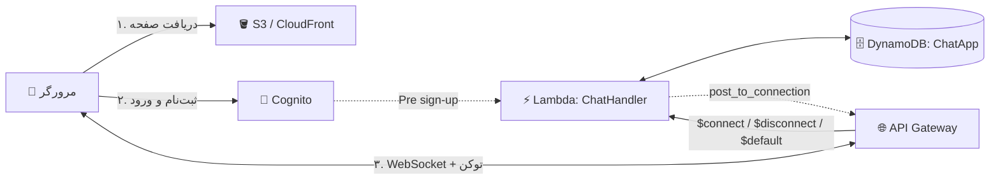

# 💬 چت‌روم بلادرنگ کلاسی (ClassChatApp) — نسخه ۲

یک چت‌روم **سرورلس** روی AWS با گفتگوی عمومی، پیام خصوصی، گروه و کانال (با مدیریت و لینک دعوت)، جستجوی کاربران و تاریخچه پیام‌ها. ثبت‌نام و ورود بدون نیاز به تأیید ایمیل یا تأیید دستی است.

---

## 📑 فهرست

1. [نمای کلی و قابلیت‌ها](#-نمای-کلی-و-قابلیتها)
2. [معماری](#-معماری)
3. [مدل داده (یک جدول)](#-مدل-داده-یک-جدول)
4. [مرحله ۱: DynamoDB](#-مرحله-۱-dynamodb)
5. [مرحله ۲: Cognito](#-مرحله-۲-cognito)
6. [مرحله ۳: IAM](#-مرحله-۳-iam)
7. [مرحله ۴: Lambda](#-مرحله-۴-lambda)
8. [مرحله ۵: اتصال Trigger به Cognito](#-مرحله-۵-اتصال-trigger-به-cognito)
9. [مرحله ۶: API Gateway](#-مرحله-۶-api-gateway)
10. [مرحله ۷: index.html و S3](#-مرحله-۷-indexhtml-و-s3)
11. [تست نهایی](#-تست-نهایی)
12. [پروتکل پیام‌ها](#-پروتکل-پیامها)
13. [نکات Free Tier](#-نکات-free-tier)
14. [عیب‌یابی](#-عیبیابی)
15. [تغییرات نسبت به نسخه قبل](#-تغییرات-نسبت-به-نسخه-قبل)

---

## 🧭 نمای کلی و قابلیت‌ها

| سرویس | نقش در پروژه |
| ----- | ------------ |
| **S3** (و اختیاری CloudFront) | میزبانی فایل `index.html` |
| **Cognito** | ثبت‌نام و ورود کاربران |
| **API Gateway (WebSocket)** | اتصال زنده و مسیریابی پیام‌ها |
| **Lambda** | **یک تابع** برای همه کارها (اتصال، قطع اتصال، پیام‌ها و Trigger ثبت‌نام) |
| **DynamoDB** | **یک جدول** برای کاربران، اتصال‌ها، گروه‌ها و پیام‌ها |
| **IAM** | دسترسی حداقلی Lambda |

**قابلیت‌ها**

- گفتگوی عمومی برای همه
- پیام خصوصی با جستجوی کاربر بر اساس شناسه، یا کلیک روی نام فرستنده
- فهرست کاربران آنلاین
- گروه (همه می‌نویسند) و کانال (فقط مدیران می‌نویسند)
- نقش‌ها: مالک، مدیر، عضو؛ حذف عضو، ارتقا و عزل مدیر، خروج و حذف گروه
- لینک دعوت (`#join=کد`) با امکان ساخت لینک جدید
- تاریخچه ۳۰ پیام آخر و دکمه «پیام‌های قبلی»
- شمارنده پیام‌های خوانده‌نشده و اتصال مجدد خودکار

---

## 🏗 معماری



توکن Cognito هنگام اتصال به‌صورت `?token=` فرستاده می‌شود و Lambda امضای آن را بررسی می‌کند. نام کاربری هیچ‌وقت از سمت کلاینت پذیرفته نمی‌شود.

---

## 🗄 مدل داده (یک جدول)

جدول `ChatApp` با کلید `PK` و `SK` و یک ایندکس `GSI1` (کلیدهای `GSI1PK` و `GSI1SK`):

| داده | PK | SK | GSI1PK / GSI1SK |
| ---- | -- | -- | --------------- |
| پروفایل کاربر | `USER#نام` | `PROFILE` | `USERS` / نام (برای جستجو) |
| فهرست پیام‌های خصوصی | `USER#نام` | `DM#طرف‌مقابل` | ندارد |
| اتصال فعال | `CONN#id` | `META` | `ONLINE` / id (برای آنلاین‌ها) |
| اطلاعات گروه | `ROOM#id` | `META` | ندارد |
| عضو گروه | `ROOM#id` | `MEMBER#نام` | `UROOM#نام` / id گروه |
| لینک دعوت | `INVITE#کد` | `META` | ندارد |
| پیام | `CHAT#شناسه‌گفتگو` | `MSG#زمان#تصادفی` | ندارد |

شناسه گفتگو: `public` برای عمومی، `room:<id>` برای گروه و کانال، `dm:<نامA>:<نامB>` (به ترتیب الفبا) برای خصوصی.

---

## 🗄 مرحله ۱: DynamoDB

1. **DynamoDB → Tables → Create table**
2. نام جدول: `ChatApp`، Partition key: `PK` (String)، Sort key: `SK` (String)
3. در **Table settings** گزینه **Customize settings** را بزنید.
4. در **Read/write capacity settings** حالت **Provisioned** را انتخاب کنید، **Auto scaling** را برای هر دو خاموش کنید و مقدار **۱۰** برای Read و **۱۰** برای Write بگذارید. (حالت On-demand جزو سهمیه همیشه‌رایگان نیست.)
5. جدول را بسازید.
6. وارد جدول شوید: **Indexes → Create index**
   - Partition key: `GSI1PK` (String)، Sort key: `GSI1SK` (String)
   - Index name: `GSI1`، Projection: **All**
   - ظرفیت Provisioned برابر **۵** و **۵**
7. **Additional settings → Time to Live (TTL) → Turn on** و نام صفت را `expiresAt` بگذارید. با این کار اتصال‌های مرده و پیام‌های قدیمی (بعد از ۳۰ روز) خودکار پاک می‌شوند.

---

## 🔐 مرحله ۲: Cognito

1. **Cognito → Create user pool**
2. نوع برنامه: **Single-page application (SPA)**، نام: `ClassChatApp`
3. Sign-in identifiers: فقط **User name**
4. Required attributes: همان `email` پیش‌فرض بماند (صفحه به‌صورت خودکار یک ایمیل ساختگی می‌فرستد)
5. Return URL: `http://localhost` (فقط برای ساخت لازم است)
6. پس از ساخت، رمز را ساده‌تر کنید: **Authentication → Authentication methods → Password policy → Edit** → حالت **Custom**، حداقل طول **۶** و همه تیک‌های الزامی (عدد، حروف بزرگ و ...) خاموش.
7. **MFA** را روی **No MFA** بگذارید.
8. در بخش **Sign-up**، گزینه ارسال پیام برای تأیید (Attribute verification) را **Disable** کنید.
9. مقدار **User pool ID** (از Overview) و **Client ID** (از App clients) را یادداشت کنید.

> نام منوها در کنسول AWS گاهی تغییر می‌کند؛ اگر دقیقاً مطابق متن نبود، همین گزینه‌ها را در همان بخش‌ها جستجو کنید.

---

## 🛡 مرحله ۳: IAM

1. **IAM → Policies → Create policy → JSON** و این متن را بگذارید (مقدار `REGION` و `ACCOUNT_ID` را عوض کنید، مثلاً `eu-north-1`):

```json
{
  "Version": "2012-10-17",
  "Statement": [
    {
      "Effect": "Allow",
      "Action": [
        "dynamodb:GetItem",
        "dynamodb:PutItem",
        "dynamodb:UpdateItem",
        "dynamodb:DeleteItem",
        "dynamodb:Query",
        "dynamodb:BatchWriteItem"
      ],
      "Resource": [
        "arn:aws:dynamodb:REGION:ACCOUNT_ID:table/ChatApp",
        "arn:aws:dynamodb:REGION:ACCOUNT_ID:table/ChatApp/index/GSI1"
      ]
    },
    {
      "Effect": "Allow",
      "Action": "execute-api:ManageConnections",
      "Resource": "arn:aws:execute-api:REGION:ACCOUNT_ID:*/*"
    }
  ]
}
```

2. نام Policy را `ChatAppAccess` بگذارید.
3. **IAM → Roles → Create role → AWS service → Lambda** و این دو Policy را اضافه کنید:
   - `ChatAppAccess`
   - `AWSLambdaBasicExecutionRole` (برای نوشتن لاگ در CloudWatch؛ بدون آن عیب‌یابی تقریباً ممکن نیست)
4. نام نقش: `ChatLambdaRole`

---

## ⚡ مرحله ۴: Lambda

1. **Lambda → Create function → Author from scratch**
2. نام: `ChatHandler`، Runtime: **Python 3.12**
3. در **Change default execution role** گزینه **Use an existing role** و `ChatLambdaRole` را انتخاب کنید.
4. محتوای فایل `lambda_function.py` را در ویرایشگر کد جایگزین کنید و **Deploy** بزنید. (Handler پیش‌فرض یعنی `lambda_function.lambda_handler` درست است و به Layer یا بسته اضافه نیاز نیست.)
5. **Configuration → General configuration → Edit**: Memory برابر **256 MB** و Timeout برابر **15 sec**.
6. **Configuration → Environment variables** این‌ها را اضافه کنید:

| نام متغیر | مقدار |
| --------- | ----- |
| `TABLE_NAME` | `ChatApp` |
| `USER_POOL_ID` | شناسه User pool از مرحله ۲ |
| `CLIENT_ID` | شناسه App client از مرحله ۲ |
| `COGNITO_REGION` | ریجن Cognito (مثلاً `eu-north-1`) |

---

## 🔗 مرحله ۵: اتصال Trigger به Cognito

این مرحله باعث می‌شود ثبت‌نام بدون تأیید ایمیل و بدون تأیید دستی انجام شود. همان Lambda قبلی این کار را هم انجام می‌دهد، پس تابع جدیدی لازم نیست.

1. **Cognito → User pool → Extensions → Add Lambda trigger**
2. Trigger type: **Sign-up** و نوع: **Pre sign-up trigger**
3. تابع `ChatHandler` را انتخاب و ذخیره کنید. (کنسول خودش اجازه فراخوانی را به Lambda اضافه می‌کند.)

> اگر در اکانت شما اضافه کردن Trigger ممکن نبود، راه جایگزین: بعد از هر ثبت‌نام، کاربر را از **Users → نام کاربر → Actions → Confirm account** تأیید کنید.

---

## 🌐 مرحله ۶: API Gateway

1. **API Gateway → Create API → WebSocket API → Build**
2. نام: `ClassChatAPI`، Route selection expression: `$request.body.action`
3. سه مسیر را به یک تابع `ChatHandler` وصل کنید:

| مسیر | تابع Lambda |
| ---- | ----------- |
| `$connect` | `ChatHandler` |
| `$disconnect` | `ChatHandler` |
| `$default` | `ChatHandler` |

4. نام Stage: `production` و سپس **Deploy**
5. آدرس **WebSocket URL** را از Stage کپی کنید (به شکل `wss://...amazonaws.com/production`).
6. اختیاری ولی مفید: در **Stages → production → Default route throttling** مقدار Rate را ۲۰ و Burst را ۴۰ بگذارید تا سوءاستفاده یا باگ کلاینت، سهمیه رایگان را مصرف نکند.

---

## 🪣 مرحله ۷: index.html و S3

1. در فایل `index.html` بخش `CONFIG` را ویرایش کنید:

```js
const CONFIG = {
  wsUrl: 'wss://API_ID.execute-api.REGION.amazonaws.com/production',
  userPoolId: 'REGION_xxxxxxxxx',
  clientId: 'xxxxxxxxxxxxxxxxxxxxxxxxxx'
};
```

2. یک Bucket بسازید و **Block all public access** را بردارید.
3. فایل `index.html` را آپلود کنید.
4. در **Properties → Static website hosting** را فعال و `index.html` را صفحه اصلی کنید.
5. در **Permissions → Bucket policy** این Policy را بگذارید (به‌جای `YOUR_BUCKET_NAME` نام Bucket):

```json
{
  "Version": "2012-10-17",
  "Statement": [
    {
      "Sid": "PublicReadGetObject",
      "Effect": "Allow",
      "Principal": "*",
      "Action": "s3:GetObject",
      "Resource": "arn:aws:s3:::YOUR_BUCKET_NAME/*"
    }
  ]
}
```

> آدرس وب‌سایت S3 فقط HTTP است. برای نمایش پروژه کافی است، ولی توکن ورود روی HTTP امن نیست. اگر خواستید HTTPS داشته باشید، یک Distribution در **CloudFront** با Origin همین Bucket بسازید (Origin access control را فعال کنید تا Bucket بتواند خصوصی بماند).

> لینک دعوت از آدرس همین صفحه ساخته می‌شود، پس بعد از انتشار نهایی، لینک‌ها را از آدرس اصلی بسازید.

---

## ✅ تست نهایی

1. آدرس سایت را در دو مرورگر (یا یک پنجره عادی و یک Incognito) باز کنید.
2. در هر کدام یک کاربر جدید بسازید (دکمه «ثبت‌نام» به‌صورت خودکار وارد هم می‌کند).
3. در گفتگوی عمومی پیام بدهید.
4. در کادر جستجو بخشی از شناسه کاربر دیگر را بنویسید و پیام خصوصی بفرستید.
5. یک گروه بسازید، از «اطلاعات» لینک دعوت را کپی کنید و در مرورگر دوم باز کنید.
6. یک کانال بسازید و بررسی کنید فقط مالک و مدیران می‌توانند پیام بگذارند.

---

## 📨 پروتکل پیام‌ها

**از کلاینت به سرور** (همه با فیلد `action`):

| action | پارامترها | کار |
| ------ | --------- | --- |
| `init` | ندارد | دریافت گروه‌ها و فهرست پیام‌های خصوصی |
| `history` | `chatId`, `before` (اختیاری) | دریافت ۳۰ پیام |
| `send` | `chatId`, `text` | ارسال پیام |
| `search_users` | `q` (خالی یعنی آنلاین‌ها) | جستجوی کاربر |
| `open_dm` | `user` | شروع گفتگوی خصوصی |
| `create_room` | `name`, `type` (`group` یا `channel`) | ساخت گروه |
| `join_room` | `code` | پیوستن با کد دعوت |
| `room_info` | `roomId` | اطلاعات و اعضا |
| `kick` | `roomId`, `user` | حذف عضو |
| `set_role` | `roomId`, `user`, `role` | ارتقا یا عزل مدیر (فقط مالک) |
| `rotate_invite` | `roomId` | ساخت لینک جدید |
| `leave_room` / `delete_room` | `roomId` | خروج یا حذف گروه |
| `ping` | ندارد | جلوگیری از قطع شدن اتصال بیکار |

**از سرور به کلاینت:** `init`, `history`, `message`, `rooms`, `focus`, `dm_opened`, `users`, `room_info`, `room_event`, `removed`, `error`

---

## 💰 نکات Free Tier

- DynamoDB با ظرفیت Provisioned زیر سقف ۲۵ واحد خواندن و نوشتن رایگان است (در این پروژه جمعاً ۱۵ واحد).
- هر پیام یک نوشتن و چند خواندن کوچک مصرف می‌کند؛ برای یک کلاس معمولی مشکلی ندارد.
- اتصال‌های باز در API Gateway بر اساس دقیقه حساب می‌شوند. پس از نمایش، پروژه را خاموش یا Stage را حذف کنید.
- اکانت‌های جدیدتر AWS ممکن است Free plan مبتنی بر اعتبار داشته باشند و سهمیه‌ها فرق کند. حتماً در **Billing** یک **Budget** با هشدار ۱ دلاری بسازید.

---

## 🛠 عیب‌یابی

| مشکل | بررسی |
| ---- | ----- |
| اتصال WebSocket برقرار نمی‌شود | متغیرهای `USER_POOL_ID`، `CLIENT_ID` و `COGNITO_REGION` در Lambda و مقدار `CONFIG` در صفحه |
| وضعیت همیشه «در حال اتصال» است | لاگ Lambda در CloudWatch؛ مسیر `$connect` باید به `ChatHandler` وصل باشد |
| خطای حساب تأیید نشده | مرحله ۵ (Trigger) |
| پیام‌ها نمی‌رسند | سطح دسترسی `execute-api:ManageConnections` در Policy و نام Stage |
| خطای AccessDenied در لاگ | ARN جدول و ایندکس در Policy مرحله ۳ |
| جستجو کاربر را پیدا نمی‌کند | کاربر باید حداقل یک بار وارد شده باشد تا پروفایلش ساخته شود |

---

## 🧾 تغییرات نسبت به نسخه قبل

- **یک جدول و یک Lambda** به‌جای دو جدول و سه تابع
- نام کاربری از **توکن Cognito** گرفته می‌شود و جعل هویت ممکن نیست؛ اتصال بدون توکن معتبر رد می‌شود
- تاریخچه اکنون **آخرین** پیام‌ها را برمی‌گرداند (قبلاً قدیمی‌ترین‌ها بود) و صفحه‌بندی دارد
- تداخل پیام‌های هم‌زمان رفع شد (کلید مرتب‌سازی یکتا شده است)
- اتصال‌های مرده پاک می‌شوند (حذف خودکار هنگام `GoneException` و TTL)
- ارسال پیام موازی شد و `scan` روی کل جدول حذف شد
- ورودی‌ها اعتبارسنجی می‌شوند (JSON خراب، متن خالی یا طولانی)
- پیام‌های خصوصی ذخیره می‌شوند و بعد از رفرش باقی می‌مانند
- فرانت‌اند با `textContent` ساخته شده و مشکل XSS ندارد؛ Ping دوره‌ای و اتصال مجدد خودکار دارد
- IAM محدود به همین جدول است و لاگ CloudWatch فعال است
