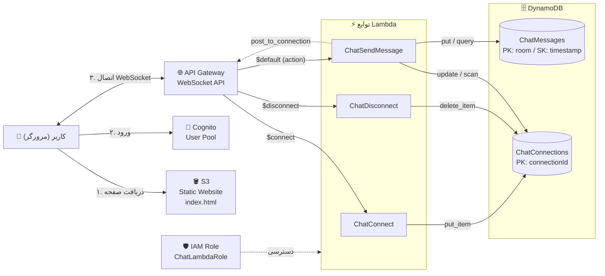
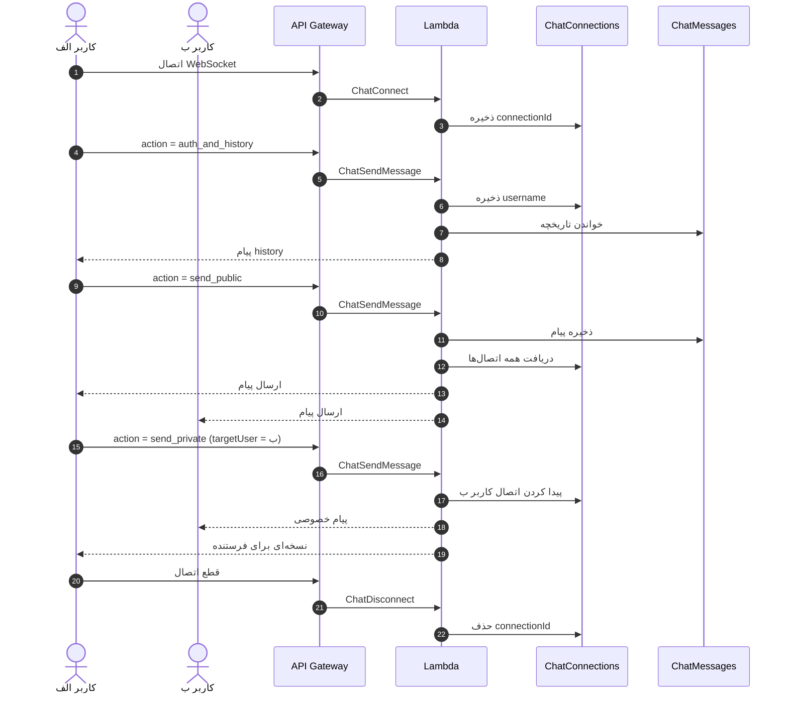

# 💬 چت‌روم بلادرنگ کلاسی (ClassChatApp)

یک چت‌روم **سرورلس** روی AWS با پشتیبانی از پیام عمومی، پیام خصوصی و تاریخچه گفتگو. ورود کاربران با Cognito انجام می‌شود، ارتباط زنده با WebSocket برقرار است و داده‌ها در DynamoDB ذخیره می‌شوند.

---

## 📑 فهرست

1. [نمای کلی](#-نمای-کلی)
2. [دیاگرام معماری](#-دیاگرام-معماری)
3. [دیاگرام توالی پیام‌ها](#-دیاگرام-توالی-پیامها)
4. [مرحله ۱: DynamoDB](#-مرحله-۱-dynamodb)
5. [مرحله ۲: IAM](#-مرحله-۲-iam)
6. [مرحله ۳: Lambda](#-مرحله-۳-lambda)
7. [مرحله ۴: Cognito](#-مرحله-۴-cognito)
8. [مرحله ۵: API Gateway](#-مرحله-۵-api-gateway)
9. [مرحله ۶: S3](#-مرحله-۶-s3)
10. [فرمت پیام‌ها](#-فرمت-پیامها)
11. [نکات و بهبودها](#-نکات-و-بهبودها)

---

## 🧭 نمای کلی

| سرویس | نقش در پروژه |
|---|---|
| **S3** | میزبانی فایل `index.html` (فرانت‌اند) به‌صورت وب‌سایت استاتیک |
| **Cognito** | ثبت‌نام و ورود کاربران |
| **API Gateway (WebSocket)** | نگه‌داشتن اتصال زنده و مسیریابی پیام‌ها بر اساس فیلد `action` |
| **Lambda** | سه تابع برای اتصال، قطع اتصال و ارسال پیام |
| **DynamoDB** | ذخیره اتصال‌های فعال و پیام‌های چت |
| **IAM** | دسترسی Lambda به DynamoDB و API Gateway |

**قابلیت‌ها**

- پیام عمومی برای همه کاربران آنلاین
- پیام خصوصی بین دو کاربر
- نمایش ۵۰ پیام تاریخچه هنگام ورود
- بدون نیاز به سرور و مدیریت زیرساخت

---

## 🏗 دیاگرام معماری



---

## 🔁 دیاگرام توالی پیام‌ها



---

## 🗄 مرحله ۱: DynamoDB

دو جدول بسازید:

| نام جدول | Partition key | Sort key |
|---|---|---|
| `ChatConnections` | `connectionId` (String) | ندارد |
| `ChatMessages` | `room` (String) | `timestamp` (Number) |

> در `ChatMessages` مقدار `room` فعلاً همیشه `public` است و `timestamp` به میلی‌ثانیه ذخیره می‌شود.

---

## 🛡 مرحله ۲: IAM

1. به **IAM → Roles → Create role** بروید.
2. گزینه **AWS service** و سپس **Lambda** را انتخاب کنید.
3. این دو Policy را اضافه کنید:
   - `AmazonDynamoDBFullAccess`
   - `AmazonAPIGatewayInvokeFullAccess`
4. نام نقش را `ChatLambdaRole` بگذارید و بسازید.

---

## ⚡ مرحله ۳: Lambda

برای هر سه تابع این تنظیمات یکسان است:

- Runtime: **Python 3.12**
- در بخش **Change default execution role** گزینه **Use an existing role** و نقش `ChatLambdaRole` را انتخاب کنید.

### ۳.۱ تابع ChatConnect

با برقراری اتصال، شناسه اتصال را در جدول ذخیره می‌کند.

```python
import boto3

dynamodb = boto3.client('dynamodb')

def lambda_handler(event, context):
    conn_id = event['requestContext']['connectionId']
    dynamodb.put_item(TableName='ChatConnections', Item={'connectionId': {'S': conn_id}})
    return {'statusCode': 200}
```

### ۳.۲ تابع ChatDisconnect

با قطع اتصال، رکورد مربوطه را حذف می‌کند.

```python
import boto3

dynamodb = boto3.client('dynamodb')

def lambda_handler(event, context):
    conn_id = event['requestContext']['connectionId']
    dynamodb.delete_item(TableName='ChatConnections', Key={'connectionId': {'S': conn_id}})
    return {'statusCode': 200}
```

### ۳.۳ تابع ChatSendMessage

مغز اصلی پروژه است و سه `action` را پشتیبانی می‌کند:

| action | کار |
|---|---|
| `auth_and_history` | ذخیره نام کاربری روی اتصال و ارسال تاریخچه |
| `send_public` | ذخیره پیام و ارسال برای همه اتصال‌ها |
| `send_private` | ارسال پیام فقط به کاربر هدف و خود فرستنده |

```python
import boto3
import json
import time
from boto3.dynamodb.conditions import Key

dynamodb = boto3.resource('dynamodb')
connections_table = dynamodb.Table('ChatConnections')
messages_table = dynamodb.Table('ChatMessages')

def lambda_handler(event, context):
    domain = event['requestContext']['domainName']
    stage = event['requestContext']['stage']
    conn_id = event['requestContext']['connectionId']
    apigw = boto3.client('apigatewaymanagementapi', endpoint_url=f"https://{domain}/{stage}")

    body = json.loads(event.get('body', '{}'))
    action = body.get('action')
    username = body.get('username', 'ناشناس')

    if action == 'auth_and_history':
        connections_table.update_item(
            Key={'connectionId': conn_id},
            UpdateExpression="SET username = :u",
            ExpressionAttributeValues={':u': username}
        )
        response = messages_table.query(
            KeyConditionExpression=Key('room').eq('public'),
            ScanIndexForward=True,
            Limit=50
        )
        clean_messages = [{'username': i.get('username', 'ناشناس'), 'message': i.get('message', '')} for i in response.get('Items', [])]
        history = json.dumps({'type': 'history', 'messages': clean_messages})
        apigw.post_to_connection(ConnectionId=conn_id, Data=history)

    elif action == 'send_public':
        msg = body.get('message')
        ts = int(time.time() * 1000)
        messages_table.put_item(Item={'room': 'public', 'timestamp': ts, 'username': username, 'message': msg})
        formatted_msg = json.dumps({'type': 'public', 'username': username, 'message': msg})
        for item in connections_table.scan().get('Items', []):
            try: apigw.post_to_connection(ConnectionId=item['connectionId'], Data=formatted_msg)
            except: pass

    elif action == 'send_private':
        target_user = body.get('targetUser')
        formatted_msg = json.dumps({'type': 'private', 'username': username, 'message': body.get('message')})
        for item in connections_table.scan().get('Items', []):
            if item.get('username') == target_user or item['connectionId'] == conn_id:
                try: apigw.post_to_connection(ConnectionId=item['connectionId'], Data=formatted_msg)
                except: pass

    return {'statusCode': 200}
```

---

## 🔐 مرحله ۴: Cognito

1. **Create user pool** و سپس نوع برنامه را **Single-page application (SPA)** انتخاب کنید.
2. نام برنامه: `ClassChatApp`
3. گزینه ورود: **Username** و **Email**
4. از بخش **Overview** مقدار `UserPoolID` را کپی کنید.
5. در بخش **Sign-up → Attribute verification** گزینه تأیید را **Disable** کنید.
6. از بخش **App client** مقدار `ClientID` را کپی کنید.
7. کاربران را به‌صورت دستی بسازید و **Confirm** کنید.

> هر دو مقدار `UserPoolID` و `ClientID` داخل `index.html` استفاده می‌شوند.

---

## 🌐 مرحله ۵: API Gateway

1. **WebSocket API → Build** را بزنید.
2. نام: `ClassChatAPI`
3. Route selection expression: `$request.body.action`
4. هر سه مسیر پیش‌فرض را فعال کنید و به Lambda وصل کنید:

| مسیر | تابع Lambda |
|---|---|
| `$connect` | `ChatConnect` |
| `$disconnect` | `ChatDisconnect` |
| `$default` | `ChatSendMessage` |

5. پس از Deploy، از بخش **Stages** آدرس **WebSocket URL** را کپی کنید (داخل `index.html` لازم است).

---

## 🪣 مرحله ۶: S3

1. یک Bucket بسازید.
2. تیک **Block all public access** را بردارید.
3. فایل `index.html` را آپلود کنید.
4. در **Properties → Static website hosting** گزینه را فعال کنید و `index.html` را به‌عنوان صفحه اصلی بدهید.
5. آدرس وب‌سایت را کپی کنید.
6. در **Permissions → Bucket policy** این Policy را بگذارید (به‌جای `YOUR_BUCKET_NAME` نام Bucket خودتان را بنویسید):

```json
{
    "Version": "2012-10-17",
    "Statement": [
        {
            "Sid": "PublicReadGetObject",
            "Effect": "Allow",
            "Principal": "*",
            "Action": "s3:GetObject",
            "Resource": "arn:aws:s3:::YOUR_BUCKET_NAME/*"
        }
    ]
}
```

---

## 📨 فرمت پیام‌ها

**از کلاینت به سرور**

```json
{ "action": "auth_and_history", "username": "ali" }
{ "action": "send_public", "username": "ali", "message": "سلام" }
{ "action": "send_private", "username": "ali", "targetUser": "sara", "message": "سلام سارا" }
```

**از سرور به کلاینت**

```json
{ "type": "history", "messages": [{ "username": "ali", "message": "سلام" }] }
{ "type": "public", "username": "ali", "message": "سلام" }
{ "type": "private", "username": "ali", "message": "سلام سارا" }
```

---

## 💡 نکات و بهبودها

- **ترتیب تاریخچه:** با `ScanIndexForward=True` و `Limit=50`، قدیمی‌ترین ۵۰ پیام برمی‌گردد. برای گرفتن ۵۰ پیام آخر، مقدار را `False` کنید و لیست نتیجه را معکوس کنید.
- **تکرار نام کاربری:** پیام خصوصی بر اساس `username` مسیریابی می‌شود. اگر دو اتصال نام یکسان داشته باشند، هر دو پیام را می‌گیرند.
- **اعتبارسنجی توکن:** Cognito فقط در فرانت‌اند استفاده شده و Lambda توکن را بررسی نمی‌کند. برای امنیت بیشتر می‌توان یک Authorizer روی `$connect` گذاشت.
- **دسترسی‌ها:** `AmazonDynamoDBFullAccess` برای آموزش مناسب است، ولی در پروژه واقعی بهتر است فقط روی دو جدول همین پروژه محدود شود.
- **مقیاس‌پذیری:** استفاده از `scan` روی `ChatConnections` برای کلاس کوچک کافی است، ولی با رشد کاربران باید جایگزین شود.
- **خطاها:** بلوک `except: pass` اتصال‌های قطع‌شده را بی‌صدا نادیده می‌گیرد؛ می‌توانید رکورد آن‌ها را هم پاک کنید.
